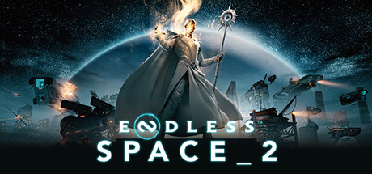

**Endless Space 2 is a gorgeous space 4X game featuring seven unique civilizations with asymmetric mechanics, deep political intrigue through the Senate system, and a streamlined approach to space empire building. One of the most accessible space 4X games made.**

---

## 📖 About

Endless Space 2 is a gorgeous space 4X game featuring seven unique civilizations with asymmetric mechanics, deep political intrigue through the Senate system, and a streamlined approach to space empire building. One of the most accessible space 4X games made.

## ⚠️ Problems Without Trainer

| Problem | Status |
|---------|--------|
| **Academy Quests** — Side quest chains require very specific strategic setups to complete | ✅ Solved |
| **Diplomacy AI** — Computer factions frequently make poor or inexplicable diplomatic choices | ✅ Solved |
| **Late Game Snowball** — Tech advantages compound quickly, making comebacks rare in single-player | ✅ Solved |
| **Population Management** — Optimizing population faction compositions across empire is very complex | ✅ Solved |

## ✅ Solution

The **ENDLESS Space 2 Trainer** solves all these issues by giving you complete control over the game.

## 🎯 Full Feature List

- Unlimited Resources
- God Mode / Invincibility
- Instant Skill Cooldown
- One-Hit Kill
- Freeze Game Timer
- Unlock All Items & Achievements
- Custom Speed Multiplier
- Save State Anywhere

## 🚀 Quick Start

1. **Disable Windows Defender** temporarily (trainer may trigger false positive)
2. Download the trainer from the button above
3. Launch ENDLESS Space 2
4. Run the trainer as Administrator
5. Activate desired cheats with hotkeys

## 💎 Free vs Paid

| Feature | Free | Pro |
|---------|------|-----|
| Basic God Mode | ✅ | ✅ |
| Unlimited Resources | ✅ | ✅ |
| All Advanced Cheats | ❌ | ✅ |
| Auto-Updates | ❌ | ✅ |
| Priority Support | ❌ | ✅ |

## 💻 Requirements

- Windows 10/11 (64-bit)
- ENDLESS Space 2 (any version)
- .NET Framework 4.8+
- DirectX 11+

## 🍎 macOS

macOS users can use our alternative tool:

## ⚖️ Legal

This trainer is for educational and single-player use only. Use responsibly.

---

